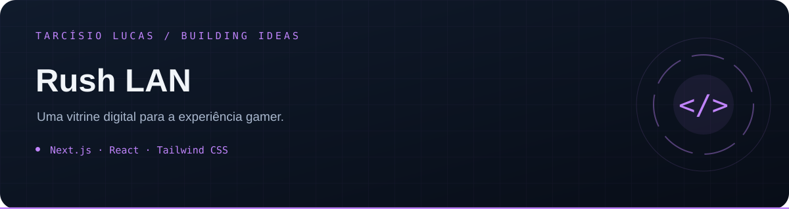

<p align="center"></p>

<p align="center"><a href="https://github.com/T-Lucas43">Perfil</a> · <a href="https://github.com/T-Lucas43?tab=repositories">Mais projetos</a> · <a href="https://www.linkedin.com/in/tarcisio-lucas-io">LinkedIn</a></p>

---

# Rush Lan House

Site público da Rush Lan House, desenvolvido para apresentar a estrutura gamer, planos, eventos, contatos e o fluxo de solicitação de reserva.

## Stack

- Next.js
- TypeScript
- React
- Tailwind CSS
- Framer Motion

## Executar localmente

```bash
npm install
npm run dev
```

Abra [http://localhost:3000](http://localhost:3000).

## Build de produção

```bash
npm run build
npm run start
```

## Configuração

Os dados públicos, preços, equipamentos, eventos e links de contato ficam centralizados em `lib/site-data.ts`.

Não há variáveis de ambiente necessárias para a versão atual.
